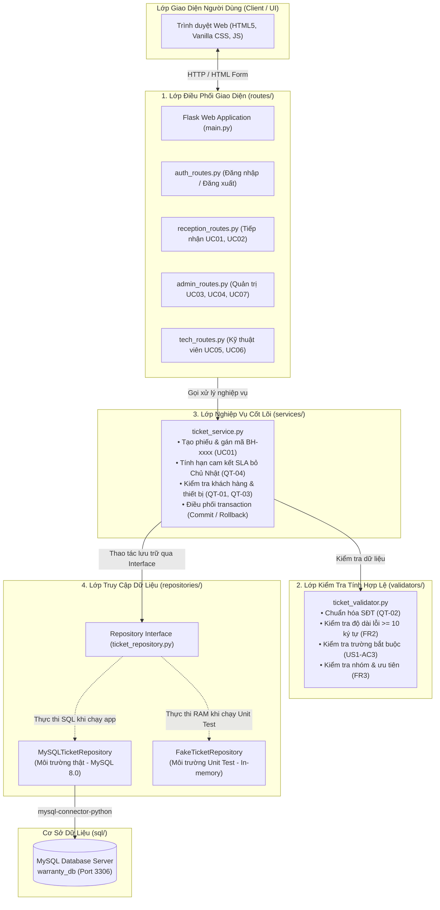

# THIẾT KẾ KIẾN TRÚC THỰC TẾ (ARCHITECTURE - TRACK SE)

- **Hệ thống:** Quản lý yêu cầu bảo hành (Luồng L2 - Smart CRM Mekong Mobile)
- **Kiến trúc áp dụng:** Kiến trúc đa tầng (Layered Architecture) kết hợp Repository Pattern & Dependency Inversion

---

## 1. Sơ đồ kiến trúc tổng thể (Architecture Diagram)

---

## 2. Chi tiết vai trò và trách nhiệm từng tầng

### 2.1. Lớp Điều phối (Presentation Layer - `src/routes/`)
- **Nhiệm vụ:** Tiếp nhận request HTTP từ trình duyệt, kiểm tra session/quyền hạn truy cập (`@login_required`), lấy dữ liệu từ form và chuyển tiếp cho tầng Service.
- **Quy tắc:** Tuyệt đối không chứa logic tính toán nghiệp vụ (như tính hạn SLA hay logic chuyển đổi trạng thái) và không gọi trực tiếp SQL.

### 2.2. Lớp Kiểm tra hợp lệ (Validation Layer - `src/validators/`)
- **Nhiệm vụ:** Đảm bảo dữ liệu đầu vào tuân thủ chặt chẽ các ràng buộc quy định trong SRS trước khi được đưa vào xử lý:
  - `QT-02`: Chuẩn hóa số điện thoại về 10 chữ số bắt đầu bằng `0`.
  - `FR2`: Kiểm tra mô tả sự cố bắt buộc có độ dài tối thiểu 10 ký tự.
  - `FR3`: Xác minh nhóm sự cố (`issue_category`) và mức ưu tiên (`priority`) nằm trong tập hợp hợp lệ.
  - `US1-AC3`: Nêu đích danh các trường dữ liệu còn thiếu.

### 2.3. Lớp Nghiệp vụ (Service Layer - `src/services/`)
- **Nhiệm vụ:** Trung tâm điều phối logic của toàn bộ luồng nghiệp vụ L2:
  - Tính toán ngày hết hạn cam kết (SLA) dựa trên mức ưu tiên (24h, 72h, 120h) và tự động bỏ qua ngày Chủ Nhật (`QT-04`).
  - Đảm bảo tính nhất quán của dữ liệu: Kiểm tra thiết bị có đang thuộc về khách hàng khác hay không (`QT-03`).
  - Sinh mã phiếu tuần tự duy nhất `BH-xxxx`.
  - Kiểm soát giao dịch: Đảm bảo nguyên tử (Atomicity), tự động `rollback` toàn bộ nếu có bất kỳ lỗi nào xảy ra nhằm bảo toàn tính toàn vẹn (`NFR3`).

### 2.4. Lớp Truy cập Dữ liệu (Data Access Layer - `src/repositories/`)
- **Nhiệm vụ:** Tách biệt hoàn toàn việc lưu trữ vật lý khỏi logic phần mềm bằng mẫu Repository Pattern.
- **Tính khả thử (Testability):**
  - Trong môi trường chạy thật, `MySQLTicketRepository` giao tiếp với MySQL Server qua thư viện `mysql-connector-python`.
  - Trong môi trường Unit Test, `FakeTicketRepository` lưu trữ dữ liệu bằng các dictionary trong bộ nhớ RAM, hỗ trợ snapshot và rollback giúp test chạy tức thì (< 0.05s) mà không làm ô nhiễm dữ liệu của hệ thống thật.
